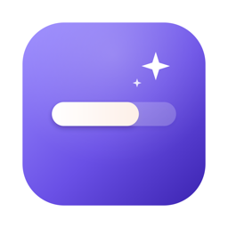
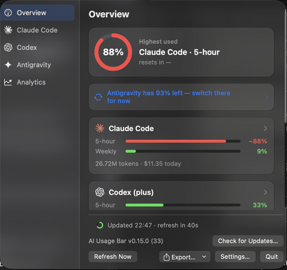
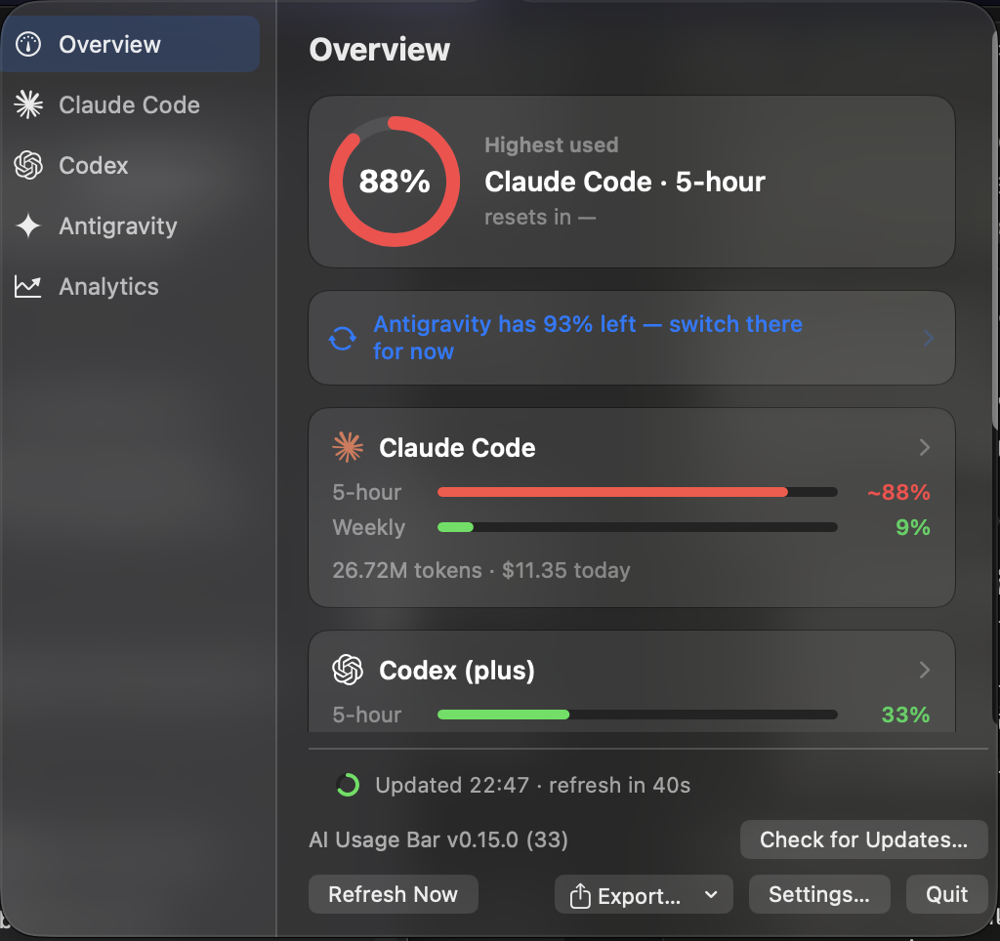
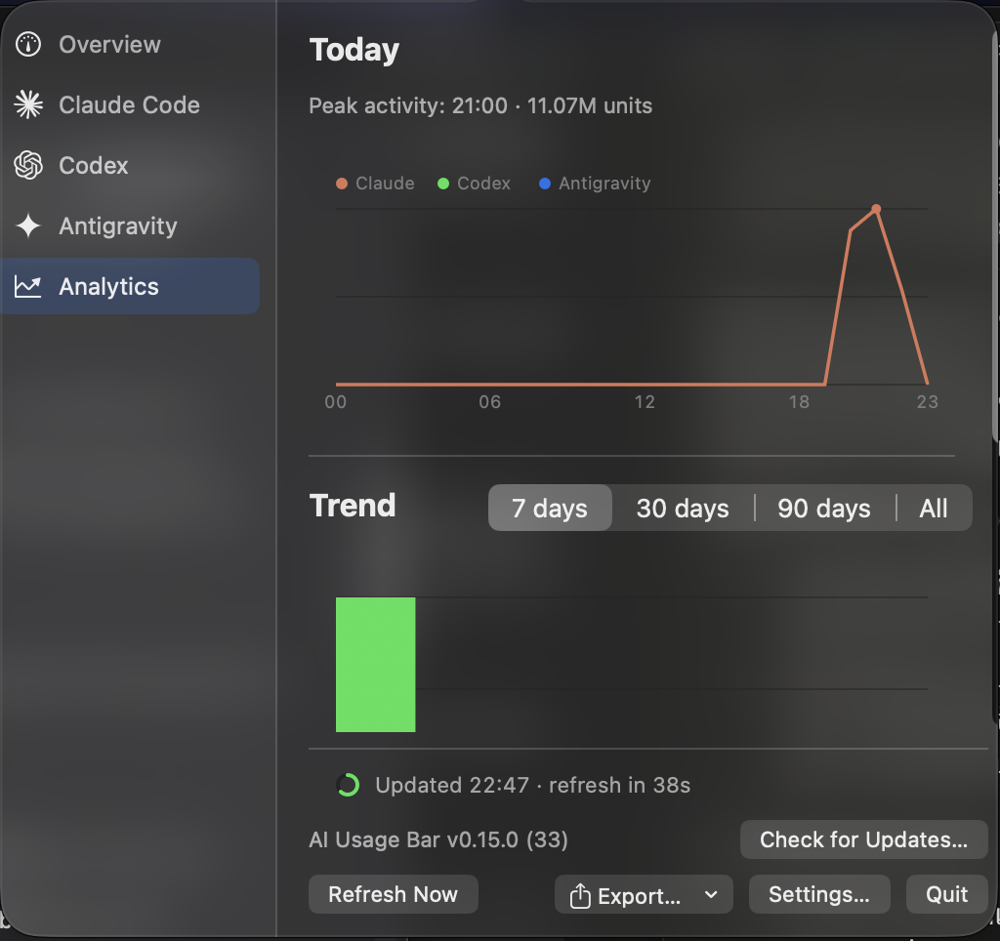

# AI Usage Bar

### Your AI limits, always one glance away.
Claude Code · Codex · Antigravity — live in the macOS menu bar.

**English** &nbsp;|&nbsp; [ภาษาไทย](README.th.md)

&nbsp;

 

  

 

## ✨ Features

| | |
|---|---|
| 📊 **Live limits** | 5-hour and weekly windows for every provider, right in the menu bar |
| 🎯 **Lowest remaining** | One ring tells you how much you have left right now |
| ⚠️ **Smart warnings** | Depletion alert and "switch there for now" hints |
| 📈 **Trends** | Daily activity and 7 / 30 / 90-day cost charts |
| 👥 **Multi-account** | Track extra Claude Code and Codex accounts |
| 🔒 **Private by design** | Reads local files only. No credentials, no network calls |

 

## 🖼️ Screenshots

&nbsp;&nbsp;

 
Overview &nbsp;·&nbsp; Analytics

 

## 🚀 Install

| Step | |
|:---:|---|
| **1** | [**Download the latest `.dmg`**](https://github.com/PerthTheIamCat/ai-usage-bar/releases/latest) |
| **2** | Open it and drag **AIUsageBar** into **Applications** |
| **3** | First launch only: **Control-click → Open** (the app is ad-hoc signed) |
| **4** | Click the menu-bar icon. Using Claude Code? Press **Set Up Status Line Bridge** once |

> The app updates itself from version 0.2.0 onward.

 

## 🔌 Supported providers

| Provider | Today's usage | Limits |
|---|---|---|
| **Claude** | Claude Code session logs | Status-line bridge or Claude Desktop |
| **Codex** | Codex session logs | Codex `rate_limits` |
| **Antigravity** | CLI history and IDE database | CLI status-line snapshot |

 

## 📚 More

[Full guide](docs/DETAILS.md) · [Changelog](CHANGELOG.md) · [Report an issue](https://github.com/PerthTheIamCat/ai-usage-bar/issues) · [MIT License](LICENSE)
